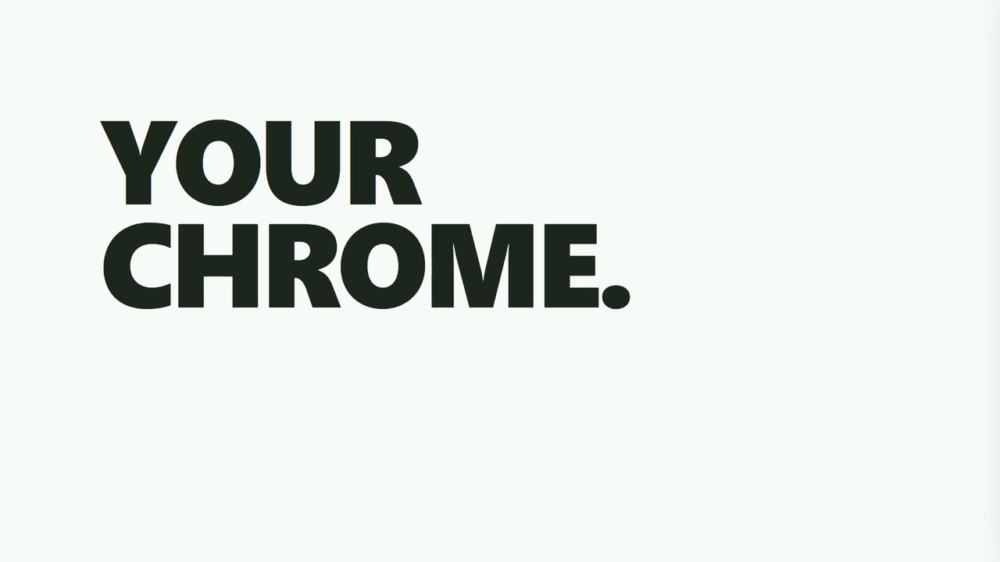

<div align="center">



<br>

[](https://github.com/Endokelp/Endoplexity/releases/latest)
[](LICENSE)
[](bridge/test)
[](#get-started)
[](#the-numbers)

**[The numbers](#the-numbers)** · **[Versus the field](#versus-the-field)** · **[How it works](#how-it-works)** · **[Get started](#get-started)** · **[Guide](docs/guide.md)**

<br>

<a href="https://cdn.jsdelivr.net/gh/Endokelp/Endoplexity@382a10b9a946740410ea6cc473849d0512feee1b/docs/endoplexity.mp4"></a>

<sub><b><a href="https://cdn.jsdelivr.net/gh/Endokelp/Endoplexity@382a10b9a946740410ea6cc473849d0512feee1b/docs/endoplexity.mp4">▶ Play the 26-second film, sound on</a></b> · every number in it is from <a href="#the-numbers">the benchmark below</a> · <a href="docs/demo.mp4">an unedited real run</a><br>Music: "Inspiring Progress" by Soundrider/Dope, <a href="https://www.jamendo.com/track/1670591">Jamendo</a>, <a href="https://creativecommons.org/licenses/by/3.0/">CC BY 3.0</a></sub>

</div>

<br>

## Why Endoplexity

<table>
<tr>
<td width="50%" valign="top">

**Your Chrome, not a new browser.**
It works in the profile you already live in: your logins, extensions and
password manager. Nothing to move into, nothing to sign in to again.

</td>
<td width="50%" valign="top">

**Your subscription, not an API key.**
Tasks run through the `claude`, `cursor-agent` or `codex` CLI you already pay
for. On top of that plan, a task costs $0.

</td>
</tr>
<tr>
<td valign="top">

**Text, never screenshots.**
The model reads the page as a compact outline, then only what changed. In 108
benchmark runs on three vendors' models, not one screenshot reached a model.

</td>
<td valign="top">

**Brakes the model cannot release.**
Irreversible clicks stop for you. A second model from a different company
reads each one first. The rules live in local code, never in a prompt.

</td>
</tr>
<tr>
<td valign="top">

**Learn once, replay free.**
Save a finished task as a skill and it runs again with no model at all:
zero tokens, the same approval gate.

</td>
<td valign="top">

**Reflexes that make it faster.**
Small decision models answer routine questions in milliseconds, so the big
model doesn't have to. Runs finish 25% faster with them on.

</td>
</tr>
</table>

## The numbers

Thirty real tasks on thirty live websites from
[Online-Mind2Web](https://github.com/OSU-NLP-Group/Online-Mind2Web), frozen
before the first run and judged blind. Against Claude in Chrome, Anthropic's
own extension, on the same model through the same CLI: only the browser tools
differ.

<table>
<tr>
<td align="center" width="33%"><h1>2.8×</h1><b>faster than Claude in Chrome</b><br><sub>task for task, same model</sub></td>
<td align="center" width="33%"><h1>0</h1><b>screenshots sent to the model</b><br><sub>Claude in Chrome sent 287</sub></td>
<td align="center" width="33%"><h1>24/30</h1><b>tasks finished on Codex</b><br><sub>on a ChatGPT plan, no API key</sub></td>
</tr>
</table>

<picture>
  <source media="(prefers-color-scheme: dark)" srcset="docs/bench-dark.svg">
  
</picture>

<sub>On the 20 tasks both finished, Claude in Chrome took longer, read more and
cost more at the median. Every row, the judging and
what the numbers don't show: <a href="docs/benchmarks.md">docs/benchmarks.md</a>.
Method and raw evidence: <a href="bench/METHOD.md">bench/METHOD.md</a>.</sub>

## Versus the field

| | **Endoplexity** | Perplexity Comet | Claude in Chrome | ChatGPT agent | Gemini in Chrome |
|---|:---:|:---:|:---:|:---:|:---:|
| Drives your own Chrome | **✓** | separate browser | ✓ | cloud browser | ✓ |
| Model never sees a screenshot | **✓** | — | — | — | not published |
| Your choice of model | **Claude, Cursor, Codex** | Perplexity's | Claude | OpenAI | Gemini |
| Extra cost on your plan | **$0** | paid plans | paid Claude plan | Plus: 40 tasks/mo | AI Pro or Ultra, US |
| Replays a task for free | **✓** | — | — | — | — |
| Open source | **✓** Apache-2.0 | — | — | — | — |

<sub>Checked 2026-11-07 from each vendor's pages and, for Comet and Claude in
Chrome, their shipped extension code. Opera Neon, Browser Use and every source:
<a href="docs/guide.md#the-full-comparison">the full comparison</a>.</sub>

### Why not just use Comet?

Comet asks you to move into a new browser, sends a JPEG of the page after
every action to Perplexity's servers, and runs a model Perplexity picks.
Endoplexity stays in your Chrome, sends text only to the model vendor you
already use, and keeps its brakes in code on your machine. That last part
matters: hidden text on a page has already walked Comet into reading a
user's one-time password
([Brave](https://brave.com/blog/comet-prompt-injection/)), and a single
crafted link walked it into leaking email and calendar data
([LayerX](https://thehackernews.com/2025/10/cometjacking-one-click-can-turn.html)).
No agent is immune to what it reads, so Endoplexity's approvals never depend
on the model behaving.

## How it works



The CLI you already have is the brain. Endoplexity adds the hands (a local
bridge with 18 browser tools) and the face (a side panel that shows every
step). The extension never talks to a model, the CLI never touches Chrome,
and the safety gate sits in between, where nothing the model says can move it.

## Reflexes: Laya and Jev

Most of what an agent decides on a page is multiple choice: which element is
the Apply button, is this click irreversible, is this a cookie wall or a
login. Reflexes answer those with small decision models instead of a frontier
model's turn.

<table>
<tr>
<td width="50%" valign="top">

**[Laya](https://huggingface.co/convaiinnovations/laya)**, local and free.
Convai's open model, 421M parameters, on your own GPU at about 100 ms a
decision. It learns from your runs: `npm run reflex:train` fine-tunes it on
what the big model decided, and keeps the new weights only if they score
better.

</td>
<td width="50%" valign="top">

**[Jev](https://typesafe.ai)**, hosted and sharp out of the box.
TypeSafe AI's decision model, 75% right on our held-out decisions with no
training, and it sees pixels: on a
bare canvas it placed three shapes at p = 0.99 and clicked each one. About
$0.0002 a decision, off by default, opt-in twice.

</td>
</tr>
</table>

A reflex earns the right to act: Shadow first, Act only after 50 decisions at
95% agreement. Any reflex may add an approval; none may remove one.

## Get started

You need Node 24+, Chrome 114+, and one of the `claude`, `cursor-agent` or
`codex` CLIs, logged in. A Claude Pro plan is enough.

```bash
git clone https://github.com/Endokelp/Endoplexity.git && cd Endoplexity
npm install
npm run setup   # Windows: start the bridge at every login
npm start       # or start it now, on any OS
```

Then open `chrome://extensions`, turn on **Developer mode**, click **Load
unpacked** and pick the `extension/` folder. Open the side panel, type what
you want done, press **Run**.

Files, Cursor and Codex logins, parallel lanes, scheduled runs, the plan lock
and the audit export are all in **[the guide](docs/guide.md)**.

## Safety, in short

- The bridge listens on `127.0.0.1` only, and only your extension's pinned
  origin can connect.
- The agent gets browser tools and nothing else: no shell, no web fetch, no
  files beyond the ones you attach, verified by asking each CLI to reach past
  its tools.
- Submitting, paying and deleting stop for your approval. Silence denies.
- Files go to a page by a key you configured, never by a path the model picks.
- Nothing the model proposes (a site note, a changed skill) is saved until you
  approve it.

The full model, including where it stops: [the guide](docs/guide.md#the-safety-model).
Found a hole? [SECURITY.md](SECURITY.md).

## Status

`v0.2.0`. Windows-first (autostart), portable everywhere else with `npm start`.
318 tests, no framework, no build step. Known gaps are listed in
[the guide](docs/guide.md#status), not hidden.

## Licence

[Apache-2.0](LICENSE). See [NOTICE](NOTICE) for trademark attribution.

<sub>Independent project. Not affiliated with, endorsed by, or sponsored by
Perplexity AI, Anthropic, Anysphere, OpenAI, Google, Convai or TypeSafe AI.</sub>
