# Endoplexity benchmarks

The full Phase 23 results. Method, judges and raw evidence: [bench/METHOD.md](../bench/METHOD.md). Back to the [README](../README.md).

Thirty tasks from [Online-Mind2Web](https://github.com/OSU-NLP-Group/Online-Mind2Web)
(real tasks on live sites, CC-BY-4.0), 10 easy, 10 medium and 10 hard, one per
website, picked by a seeded hash written down and committed
([`597aec8`](https://github.com/Endokelp/Endoplexity/commit/597aec8)) before
anything ran. Each run was judged blind against the benchmark's own key
points by two model judges, with a third read on every split. The method,
every judge's reasoning and the raw evidence:
[bench/METHOD.md](../bench/METHOD.md).

<picture>
  <source media="(prefers-color-scheme: dark)" srcset="bench-dark.svg">
  
</picture>

### Head to head: one model, one CLI, two sets of browser tools

Claude in Chrome is Anthropic's own extension. Both rows below run Claude
Sonnet 5.5 through the same `claude` CLI with the same token accounting; the
only thing that differs is the browser tools the model is handed.

| | Endoplexity | Claude in Chrome |
|---|---|---|
| Tasks completed, of 30 | 22 | **25** |
| Median time, the 20 both finished | **31 s** | 57 s |
| Median actions, same 20 | **7.5** | 11.5 |
| Median tokens, same 20 | **239k** | 283k |
| Median API-equivalent cost, same 20 | **$0.23** | $0.29 |
| Screenshots sent to the model, all 30 | **0** | 287 |

Compared task by task, Claude in Chrome took 2.8× as long, used 1.9× the
actions, 1.4× the tokens and 1.3× the cost (medians of per-task ratios).
It also finished three more tasks.

### Every row

| Condition | Model | Finished | Easy | Medium | Hard | Median time | Median actions | Screenshots |
|---|---|---|---|---|---|---|---|---|
| Endoplexity, reflexes off | Claude Sonnet 5.5 | 22/30 | 9/10 | 6/10 | 7/10 | 44 s | 12 | 0 |
| Endoplexity, reflexes in Act | Claude Sonnet 5.5 | 21/30 | 7/10 | 7/10 | 7/10 | 33 s | 10 | 0 |
| Endoplexity | Codex, `gpt-6.1-sol` | **24/30** | 9/10 | 8/10 | 7/10 | 40 s | 13 | 0 |
| Endoplexity | Cursor, `grok-4.7-medium` | 13/18 | 3/5 | 7/9 | 3/4 | 114 s | 18 | 0 |
| Claude in Chrome 1.0.105 | Claude Sonnet 5.5 | **25/30** | 8/10 | 8/10 | 9/10 | 77 s | 14 | 287 |

Cursor's row stopped at 18 tasks (why is in METHOD.md), so its count is not
comparable with the 30-task rows. Token counts are only compared within one
vendor; each CLI counts differently.

**Reflexes in Act** (Gate and Settle earned; Pick and Obstacle still in
Shadow) cut the median task from 44 s to 33 s and the median cost from $0.40
to $0.32. They finished one task fewer, which on 30 tasks is inside the noise.

**For context, not competition:** the Online-Mind2Web authors had humans judge
six agents on these same 30 tasks in 2025: Claude Computer Use 3.7 finished
21, OpenAI Operator 17, SeeAct 11, Claude Computer Use 3.5 10, Agent-E 9 and
Browser Use 8. Different months, changed sites and human judges, so these are
not a head-to-head with the rows above.

### What these numbers do not show

- **Thirty tasks is a small sample.** One task is 3.3 points, so 22 against
  25 is a real gap but not a precise one.
- **The judges are models.** Two Claude Sonnet 5.5 judges per run, Codex for
  the runs left when Claude's usage limit ran out, and a third read by Claude
  Opus 5.5. Claude judging Claude's runs is a bias risk that blind packets
  reduce and do not remove. Fifteen Claude in Chrome runs had their end state
  rebuilt from their own stream after a harness bug and were read once.
  METHOD.md has the details, and every verdict with its reason.
- **Comet, Gemini in Chrome and ChatGPT agent are not in the table.** Their
  agents run on the vendor's servers and report no tokens, so they could not
  be measured the same way.
- One laptop, one home connection, two days in November 2026. Live sites
  change; a rerun will not match to the task.

